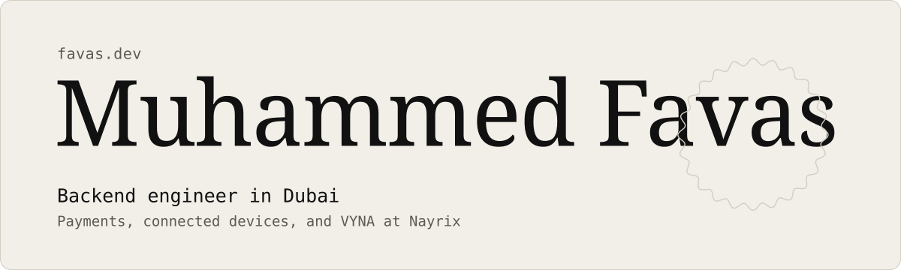
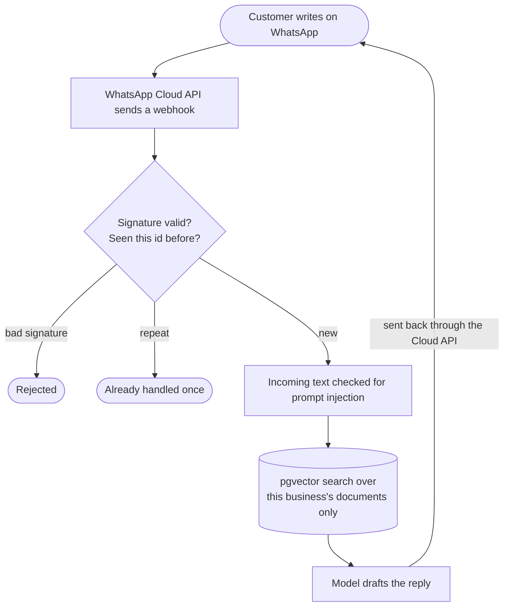

<picture>
  <source media="(prefers-color-scheme: dark)" srcset="assets/header-dark.svg">
  
</picture>

I build the server side of payments and connected devices. With Muhammed Roshan M, I co-founded Nayrix, a small studio, where we're building VYNA, an AI receptionist for WhatsApp.

[favas.dev](https://www.favas.dev) · [Writing](https://www.favas.dev/thoughts) · [LinkedIn](https://www.linkedin.com/in/muhammed-favas-t-p) · [hi@favas.dev](mailto:hi@favas.dev)

## Now

| Where | What | Since |
| --- | --- | --- |
| SureFlow Research & Development Centre, Dubai | Backend developer | Jun 2026 |
| [Nayrix](https://nayrix.com) | Co-founder, building [VYNA](https://vyna.nayrix.com), in early access | Oct 2025 |
| Mercor | AI trainer, LLM evaluation and writing, on contract | Jul 2026 |
| Tegrand Infotech, Kerala | Intern, then junior full-stack engineer, then technical lead | 2023 to 2025 |

## How a VYNA message travels

A webhook that arrives twice is handled once, and one business's documents never reach another's replies.

## Selected work

| Project | What it is | Built with |
| --- | --- | --- |
| [VYNA](https://vyna.nayrix.com) | AI receptionist for a business's WhatsApp | Django, Next.js, PostgreSQL, pgvector |
| [Renex](https://renex.app) | Property portal, built end to end at Tegrand | Next.js, Django REST Framework, PostgreSQL |
| [Alucidate](https://github.com/favasMuhammed/Alucidate-v2) | Study tutor for textbook PDFs whose answers cite the page, co-built with Roshan | React, Gemini API, PDF.js |

More on this account

- [Everly Modish ERP](https://github.com/favasMuhammed/Everly-Modish): point of sale and inventory on Google Apps Script
- [Restaurant reservations](https://github.com/favasMuhammed/restaurant-reservation-system): WordPress, PHP and Stripe
- [AI exam proctor](https://github.com/favasMuhammed/AiExam-django): Django and OpenCV
- [Car rental](https://github.com/favasMuhammed/Car-Rental-Solution): React, TypeScript and Node.js

The full record, with what each project led to, is at [favas.dev](https://www.favas.dev/#work).

## Recent writing

- [I published a result where nothing won](https://www.favas.dev/thoughts/publishing-a-result-where-nothing-won), Nov 2026
- [What grading AI answers taught me about writing](https://www.favas.dev/thoughts/what-grading-ai-answers-taught-me-about-writing), Sep 2026
- [Sent is not delivered](https://www.favas.dev/thoughts/sent-is-not-delivered), Jul 2026

## Tools

| Area | Tools |
| --- | --- |
| Backend | Python, Django, Django REST Framework, Celery, MQTT |
| Data | PostgreSQL, pgvector |
| Front end | TypeScript, React, Next.js |
| Infrastructure | Docker, AWS, GitHub Actions |

On the side I run a small lab that re-tests published claims about quantum compilers: [heyfavas-cell](https://github.com/heyfavas-cell).

The header is one day in Dubai, an hour a second. The shadow on the name falls where the real sun would cast it on a south-facing wall, drawn from the same code as [favas.dev](https://www.favas.dev).
